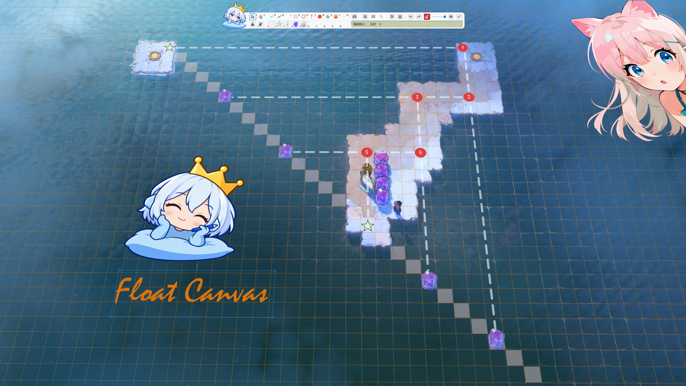

# FloatCanvas 浮绘

<div align="center">

[简体中文](README.md) · **English**

</div>

A Windows screen annotation tool. Draw over your desktop, place images and edit objects, then return to the application underneath while your annotations stay visible.



Current source version: **0.3.0**. See [Releases](https://github.com/yowynn/FloatCanvas/releases) for published versions and downloads, the [changelog](CHANGELOG.md) for important changes, and the [user guide](Docs/User-Guide.en.md) for instructions. Billboard placement and depth-priority occlusion remain experimental and off by default.

The toolbar separates gray New and red-broom Clear. New confirms according to file and edit state; Clear is immediate, undoable and adds no history. A folding filename bubble shows the bound project. Stamp-slot context menus contain four maintenance actions: Rename, Overwrite, Delete and Unpin.

## Features

- Freehand pen, highlighter, lines and arrows, shapes, text, separate numbered markers, symbols and emoji; official/custom presets apply complete tool parameters, using defaults for new parameters missing from older presets. Per-tool preset selections and edited parameters persist across restarts, with single-click shape creation at a default size.
- Import PNG, JPEG, BMP, GIF and WebP through files, the clipboard or drag and drop. GIF/animated WebP retain their original data and play; move, rotate, resize, group and edit image objects. Images and new captures support outward borders following their visible pixel contours, including each animation frame.
- Two aligned toolbar rows with a shared visibility switch for tool and stamp shortcut hints; movable, pinnable Tool options, Properties and Layers windows. Property edits apply immediately, with numeric entry, drag adjustment and segmented choices. Color and parameter drags can be cancelled; preset and swatch management shares canvas undo/redo.
- Editing and canvas visibility are independent. Create while hidden with a preview of only the current operation; commit to reveal the complete canvas or cancel to keep it hidden. Existing hidden layers cannot be selected or modified.
- Canvas is a tool exclusive with the drawing tools: click it or press `C` to select it with a blue border, then select it again for its options. Document (0,0) is the upper-left logical zero. The flat grid stays on a fixed reference-display center intersection; drag anywhere, including over layer pixels, to resize it. With perspective, the nine-point pin, logical origin and central move handle have separate roles.
- Independent canvas background color and opacity, corner dragging or unordered four-corner placement, solid/dashed/dotted grids, and official/personal presets. Flat mode has one Grid size field; perspective shows columns before rows. Reset restores an unwarped 1:1 document view and rebuilds square cells for the current coverage at the target display center. Version 8 saves the pin, fixed default reference and layer placement and reads v1–v7 projects. Default Surface objects follow projection; experimental Billboards choose an equal-depth line and face the screen while scaling with anchor depth.
- Strong perspective can include the horizon on screen, with grids and Surface content clipped to a safe boundary. Hovering over an unsafe area while editing softly tints its extent red. On release, cancel, relocate, delete, or keep the original layers so adjusting the perspective back restores their display (use with caution), in one undoable operation.
- The spatial nine-point pin defaults to bottom left and fits complete odd-count grids. Solve each adjustment from the fixed reference and final parameters, without accumulated deformation. **Keep grid size while adjusting** fixes logical spacing and pin phase so layers remain aligned to their original grid lines; corners move freely while exact fractional coverage updates automatically. Explicitly editing the flat grid size establishes new counts and a reference frame, replacing the previous perspective deformation.
- Enable perspective in Canvas tool settings to expose Depth-priority occlusion, interleaving billboards and Surface content by anchor depth and using layer order at identical depth. Canvas color and the grid remain below all objects; overall opacity applies after composition. The option is off by default and saved with canvases and canvas presets.
- Hold `Shift` while moving to constrain movement to a canvas X/Y axis through the original drag start. A billboard's body moves its anchor; its center handle adjusts elevation vertically on screen, including negative elevation, and corner resizing uses the center as its origin.
- Reopen Welcome from the main menu or tray. Pass-through shows a smaller mascot holding her crown in both hands, without a pen. Wearing the crown means editing; holding it means pass-through. Open/closed eyes indicate a visible/hidden canvas. Click to enter editing, double-click for visibility, or disable the floating mascot in Settings.
- A stamp library with editable and flattened stamps, search, continuous scrolling, drag reordering and a ten-slot shelf ordered `1`–`9`, then `0`. Pin by dragging onto a slot or selecting a slot and clicking an entry. Editable groups retain animation when the library is reopened and the stamp is placed again.
- Rectangle, Circle and lasso captures place a static image at the selected position, using the background, background + canvas, or transparent canvas content. Rectangle/Circle selections resize freely by default; hold Shift for a 1:1 constraint. Surface selections follow the canvas plane; lassos trace screen contours. Billboard captures choose depth first and retain their captured pixel appearance. Includes single-image cropping, live blur and pixelation, and PNG/JPEG export. New canvas and Clear current canvas are separate actions; clearing supports Undo and retains the file association.
- Self-contained, editable `.floatcanvas` projects, Windows file-type registration and handoff to an already running instance. **Revert changes** in the filename bubble reloads the last saved content and supports Undo. Automatic recovery saves, a blank canvas on normal startup, and manual workspace-history restoration. History filters blank and duplicate versions; its configurable limit defaults to 60. New canvas detaches the file association; Clear preserves it and supports Undo. Optional sign-in startup is off by default.
- Light/dark themes and all-screen scope for new configurations, with primary-screen-only and individual-display options. Switching screens preserves document geometry and undo history.
- Automatic, Enhanced and Ordinary fullscreen overlay modes. Automatic checks for enhancement support by default. Windows screen clipping and ShareX fullscreen captures receive display and input handoff, with the canvas restored afterward.
- GPU preference is on by default: eligible filter scenes use the GPU, while light canvases use CPU caching. Depth-priority occlusion currently uses CPU composition. Settings shows the last frame's actual backend and selection reason; unavailable or failed GPU rendering falls back to the CPU.
- Simplified Chinese and English interfaces, with automatic Windows display-language selection.
- Check GitHub releases in the app, download and install updates, then restart automatically.

Billboard creation is off by default and affects only new objects. Leaving it off retains existing tool workflows; the general Shift movement constraint and corrected Surface capture outlines apply independently. Disabling perspective resets new-object placement while preserving existing billboard data. Older apps cannot read newly saved v8 projects; retain the original file when exchanging with them.

Animation requires the original file or encoded data. Clipboard sources supplying only PNG/Bitmap produce a static image; FloatCanvas does not fetch the original online. Hiding pauses refresh and pass-through keeps playback running. Snapshots, exports and merged image stamps take a static frame; animated export and playback controls are not available.

## Download and use

Windows x64 binaries are provided through the repository's [Releases](https://github.com/yowynn/FloatCanvas/releases). The published 0.3.0 release provides a ZIP. Starting with the next release, each version will offer both unsigned formats below, each with its own `.sha256` checksum file:

- **Installer: `FloatCanvas-<version>-win-x64-Setup.exe`** installs for the current user, by default under `%LOCALAPPDATA%\Programs\FloatCanvas`, without requiring administrator rights to install the app. It creates a Start menu entry and a Windows uninstall entry, with an optional desktop shortcut. It does not enable login startup automatically.
- **ZIP: `FloatCanvas-<version>-win-x64.zip`** lets you manage the application directory yourself. Extract it to a local folder writable by your Windows account, keep all files together, and run `FloatCanvas.exe`.

Both formats contain the same application files and exclude the .NET runtime and debug symbols (PDB files). They share the default user profile under `%LOCALAPPDATA%\FloatCanvas`; uninstalling the installed app retains settings and projects. A compatible **.NET 10 Windows Desktop Runtime x64** must be installed. You can also build from source using the instructions below; a source checkout does not include packaged binaries.

The installer offers Simplified Chinese and English, initially follows the Windows display language, and lets you choose manually. Before installation, it checks for a compatible stable .NET 10 Windows Desktop Runtime x64. If it is missing, open the official Microsoft download page, install the runtime yourself, then choose **Check again**. Setup can continue only after the check passes; it does not download or install the runtime automatically. **Launch FloatCanvas** is selected on the completion page and can be cleared.

For the ZIP edition, a missing compatible runtime causes the launcher to display a .NET installation prompt. Click **Download** to open Microsoft's download page, download and run the **Windows Desktop Runtime x64** installer, then start FloatCanvas again. You can also find it on the official [.NET 10 download page](https://dotnet.microsoft.com/download/dotnet/10.0). Running FloatCanvas does not require the SDK.

Click the version at the bottom of the welcome screen to open **Check for updates**. It checks this project's GitHub releases automatically and always links to the [project page](https://github.com/yowynn/FloatCanvas). When an update is available, choose **Update now** to download, verify and replace the app, then restart automatically. No manual extraction or overwriting is needed. Both formats update through the official ZIP; installed copies also refresh their version in the Windows uninstall entry. Updates default to stable releases; enable **Include preview releases** to opt in. Current-version notes remain available when there is no update. See [updating the app](Docs/User-Guide.en.md#check-and-install-updates).

| Shortcut | Action |
| --- | --- |
| `` Ctrl+` `` | Switch edit/pass-through; annotations remain visible while you use the application underneath |
| `` Ctrl+Shift+` `` | Hide canvas / Show canvas; keep the current edit/pass-through mode |
| `Tab` | Expand/collapse the toolbar while editing; text fields, menus and dialogs keep their own key behavior |
| `Esc` | Cancel the operation or close child/unpinned panels first; then enter pass-through |
| `Ctrl+Z` / `Ctrl+Y` (or `Ctrl+Shift+Z`) | Undo/redo canvas edits and personal preset operations in order |
| `Ctrl+S` / `Ctrl+O` | Save/open an editable project |

Click the app icon on the left of the toolbar to open the main menu after a short delay, or right-click to open it immediately. Double-click the logo in either edit or pass-through mode to show/hide the canvas, and drag it to move it. Press `Tab` or use the main menu's first item, **Collapse toolbar / Expand toolbar**, to fold or unfold the toolbar; right-click still opens the menu when folded. Clicking or right-clicking the pass-through logo only enters editing and does not open the main menu. Settings and exit commands are available through the main menu and system tray. See the [user guide](Docs/User-Guide.en.md) for more.

Tool keys: `V` select, `E` eraser, `B` freehand, `H` highlighter, `L` line, `R` rectangle, `O` circle, `T` text, `N` numbered marker, `S` symbol, `J` emoji and `C` Canvas. `A` remains an arrow compatibility shortcut; `M` opens **More**, main-keyboard `-` opens the stamp library, and `+` saves the selection as a stamp. Letters remain normal text input while editing text.

## Languages and scope

Under **Main menu → Settings… → Language / 界面语言**, choose Automatic (`auto`), 简体中文 (`zh-CN`) or English (`en`). Save and restart to apply the change. Automatic follows the Windows display language: Chinese display languages use Simplified Chinese; other languages use English. Interface language is independent of annotation content, keyboard layout and input methods. [English](Docs/User-Guide.en.md) and [Chinese](Docs/User-Guide.md) guides are available.

The minimum system baseline is **Windows 10 1607 (build 14393) x64**, including LTSB 2016, LTSC 2019 and LTSC 2021; Windows 11 x64 is also targeted. Install a compatible .NET 10 Windows Desktop Runtime and keep Windows and the runtime updated. Microsoft's official support also depends on the Windows version, edition and lifecycle. Testing has mainly used Windows 11; earlier Windows 10/LTSB/LTSC versions still need testing on real systems. New configurations default to all screens, with a primary-screen-only option. Complete cross-screen, mixed-DPI and dual-4K behavior remain under development. Fullscreen compatibility depends on the application and display mode; not every exclusive-fullscreen scenario is guaranteed.

Choose the fullscreen overlay mode under **Settings → System**, then restart. Automatic falls back to ordinary desktop windows on current detection, initialization or recoverable runtime failures, retaining the canvas and undo history. Forced Enhanced has no automatic fallback; Ordinary does not load enhanced interfaces. If enhancement prevents startup, exit first and use `FloatCanvas.exe --desktop-mode` to open Settings. When the interface is genuinely stuck, releasing input still depends on its recovery; in-place recovery is not guaranteed. See [Start and switch modes](Docs/User-Guide.en.md#start-and-switch-modes).

**Live blur and pixelation require Windows 10 2004 (build 19041) or later.** Earlier systems use static snapshots for new desktop filter regions; frozen-screenshot and image effects remain available. Existing live regions loaded from projects use solid coverage with a warning on earlier systems, retaining the original objects for editing on a supported system.

When the system supports session-local window exclusion, live filters exclude FloatCanvas only from its own capture, leaving the visible canvas available to other capture tools. Older systems use a compatibility path: external screenshots may omit the canvas while live blur or pixelation is visible. Use the in-app export for a complete composite, or remove or hide the live regions before capturing. Window detection in Windows Snipping Tool still has a known limitation.

Annotations stay at screen coordinates; they do not follow web scrolling, game cameras or objects. HDR color accuracy, pressure-sensitive pens, touch, OCR, recording, scrolling capture, cloud synchronization and uploads are outside the current scope.

Perspective calibration needs readjustment when the camera moves. Dense grids at high resolutions can noticeably slow CPU rendering; reduce the row or column count, or hide the grid.

## Build from source

Requires Windows x64, .NET SDK 10.0.402 (resolved according to `global.json`), and Visual Studio / Build Tools with **Desktop development with C++**, including the MSVC x64/x86 compiler and a Windows SDK. Both the native overlay and recovery launcher use this toolchain; the .NET SDK alone is insufficient.

Select that workload in Visual Studio Installer, or run the Microsoft Build Tools installer you downloaded:

```powershell
./vs_BuildTools.exe --add Microsoft.VisualStudio.Workload.VCTools --includeRecommended --passive --wait
```

Default tests include native input contracts without injected input. Actual game and device tests remain separate.

```powershell
./scripts/Build.ps1
./scripts/Test.ps1
dotnet run --project src/FloatCanvas.App -c Release
```

Build a Windows Release package without the .NET runtime or PDB files, and check its extracted startup. The version is read automatically from the application project. The startup check requires a compatible desktop runtime:

```powershell
./scripts/Publish.ps1
./scripts/Smoke-Package.ps1
./scripts/Publish-Installer.ps1 -ZipPath ./dist/FloatCanvas-0.3.0-win-x64.zip
```

The installer script uses the verified ZIP to produce `-Setup.exe` and its `.sha256` file in the same directory. It downloads a pinned Inno Setup compiler; no code-signing certificate is required. Adjust the example version to match your build.

Optional output on another drive: `./scripts/Publish.ps1 -OutputDirectory 'C:\FloatCanvas\dist' -ArtifactsPath 'C:\FloatCanvas\build'`. Packages and main build intermediates use those locations; small publish dependency lock files remain in ignored source `obj` directories.

## Release a source version

After pushing to a repository with GitHub Actions enabled, branch updates and pull requests run CI. To publish, push a `v<Version>` tag matching the application project's `Version`, or manually run the release workflow and select an existing tag. The workflow builds, tests, packages and smoke-tests the extracted app, then creates a Release with the ZIP, EXE installer and their individual SHA-256 files attached. Both formats are unsigned. Changing the version alone does not publish a release; existing releases and assets are not overwritten.

## License

Maintained by **Heptayo**. The project code is licensed under [MIT](LICENSE). See [third-party notices](THIRD-PARTY-NOTICES.md) / [licenses](licenses) for distributed dependencies.

FloatCanvas is independently implemented, drawing on published technical and interaction references from ppInk and ShareX.
